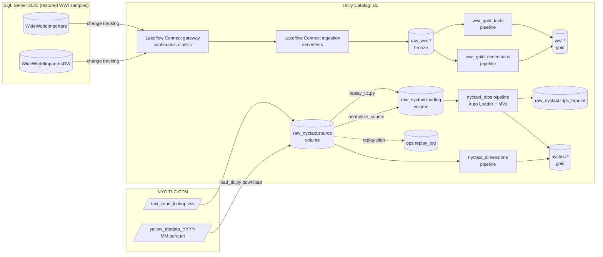

# Shared Data Platform — Architectural Guide

Governing scope: `01-spec/SPEC.md` v1.1 § 4 (shared platform), § 5 (canonical schema), § 9.4 (freshness protocol), § 13 (Phase 2 exit criterion). Every stack in the study (SSAS Multidimensional, Power BI / Tabular, Tableau, Databricks Metric Views) reads the gold tables this platform publishes. No stack keeps its own copy of the source data.

---

## 1. Topology



| Layer | Schema | Written by | Consumers |
|---|---|---|---|
| Bronze, WWI | `slc.raw_wwi` | Lakeflow Connect ingestion pipeline (SCD Type 1, source column names kept) | `wwi_gold_*` pipelines, profiling |
| Bronze, NYC | `slc.raw_nyctaxi` (`trips_bronze`, volumes `source`, `landing`) | `load_tlc.py`, `replay_tlc.py`, Auto Loader flow in `nyctaxi_trips` | `nyctaxi_trips`, profiling |
| Gold | `slc.wwi`, `slc.nyctaxi` | four Lakeflow pipelines (serverless, materialized views) | every semantic layer stack, the oracle (SPEC § 9) |
| Ops | `slc.ops` | `replay_tlc.py` | freshness pollers (SPEC § 9.4) |

---

## 2. Component inventory

| Component | Technology | Source |
|---|---|---|
| Bundle root, targets `baseline` and `freshness` | Declarative Automation Bundle, `engine: direct` | `databricks.yml` |
| Catalog, schemas, volumes | Bundle `catalogs`, `schemas`, `volumes` resources | `resources/catalog.yml` |
| WWI ingestion | Lakeflow Connect SQL Server gateway + ingestion pipelines, change tracking | `resources/wwi_ingestion.yml` |
| WWI gold | Lakeflow pipelines (`pyspark.pipelines`), materialized views | `resources/wwi_gold.yml`, `src/pipelines/wwi_gold_*` |
| NYC gold | Lakeflow pipelines: Auto Loader streaming table + materialized views | `resources/nyctaxi.yml`, `src/pipelines/nyctaxi_*` |
| Orchestration | Lakeflow Jobs: build, profiling, replay | `resources/jobs.yml` |
| Transform library | PySpark, pure functions (no I/O) | `src/slc_platform/` |
| Canonical schema (single source of truth) | Python | `src/slc_platform/schema.py` |
| Source preparation | T-SQL (sqlcmd) | `src/sql/source/` |
| UC connection | Databricks SQL | `src/sql/setup/sqlserver_connection.sql` |
| Profiling assertions | Spark SQL + generated PK/FK/NOT NULL checks | `src/sql/profiling/`, `src/slc_platform/profiling.py` |
| Local real-data B0 | PySpark + SQL Server JDBC | `tools/local_b0.py` |
| Test suite | unittest | `scripts/test_platform.py` |

---

## 3. WideWorldImporters path

### 3.1 Source preparation and the columnstore finding

The source is the official `v1.0` sample release restored onto SQL Server 2025 (`src/sql/source/01_wwi_restore.sql`). Lakeflow Connect's SQL Server connector needs change tracking (tables with primary keys) or CDC (tables without) on every ingested table. All eleven ingested tables have primary keys, so change tracking is the method.

**Finding.** All six `WideWorldImportersDW` fact tables carry a clustered columnstore index. SQL Server rejects both change tracking and CDC on them:

```
Msg 35353: Change Tracking cannot be enabled on a table with a clustered columnstore index.
Msg 35353: Change Data Capture cannot be enabled on a table with a clustered columnstore index.
```

Microsoft documents the same restriction ("You can't use change tracking with columnstore indexes"; CDC only with a nonclustered columnstore index, V-21). `02_wwi_source_prep.sql` therefore drops `CCX_Fact_Sale`, `CCX_Fact_Order`, `CCX_Fact_Movement` and `CCX_Fact_Stock_Holding` on the staging copy. The rows and primary keys don't change. On the restored copy, `Fact.Sale` had 228,265 rows and a `[Total Excluding Tax]` sum of 172,261,341.20 both before and after. The tables become rowstore heaps keyed by their existing nonclustered primary keys.

This is the first data point for the boundary analysis: a CDC-style managed ingestion path forces a physical-design change on a columnstore warehouse source. The same constraint applies to any change-tracking or CDC-based replication of that source, not only to Lakeflow Connect.

The script is idempotent and grants exactly the privileges the connector documents (`VIEW ANY DATABASE`, catalog-view `SELECT`, `sp_tables` / `sp_columns_100` / `sp_pkeys` / `sp_statistics_100`, `VIEW DATABASE PERFORMANCE STATE`, `SELECT` and `VIEW CHANGE TRACKING` per table). The test suite runs it twice against the restored copy. The least-privilege `slc_ingest` login then reads all tables and `CHANGETABLE(CHANGES ...)`. Databricks' own utility objects script is installed separately, and `03_wwi_lakeflow_utility.sql` calls `lakeflowSetupChangeTracking` with `@Tables = NULL` (database-level setup only), because table-level change tracking is already enabled natively.

### 3.2 Ingestion

`resources/wwi_ingestion.yml` declares one gateway (continuous, classic compute; the connector requires both) and one serverless ingestion pipeline with eleven table-level objects. Each `destination_table` is a deterministic snake_case name (`dw_fact_sale`, `oltp_warehouse_stockgroups`, …). `slc_platform.wwi.BRONZE` is the code-side copy of that list, and the bundle test fails if the two drift apart. Bronze keeps source column names such as `` `Sale Key` `` (V-24 pending: verify on first deployment).

### 3.3 Gold

| Gold table | Transform | Notes |
|---|---|---|
| `dim_date` | `calendar.dim_date(2013-01-01, 2016-12-31)` | Fiscal year starts 1 November, labeled by end year. Profiling compares every date against `[Dimension].[Date]` (P-WWI-01). |
| `dim_stock_item`, `dim_customer`, `dim_city`, `dim_employee` | `wwi.conform` | SCD Type 2; `is_current` rule in § 3.4 |
| `dim_stock_group`, `bridge_stock_item_group` | `wwi.conform` | From OLTP `Warehouse.*`; bridge keyed on the durable item id |
| `fact_sale`, `fact_order`, `fact_stock_movement`, `stock_holding_current` | `wwi.conform` | Rename and cast only; row counts equal bronze (P-WWI-07) |
| `fact_stock_holding_daily` | `wwi.fact_stock_holding_daily` | Derived dense snapshot (§ 3.5) |

`wwi.conform` is driven by `MAPPINGS` (gold column ← source column) and `schema.WWI_TABLES` (types). It casts explicitly. Serverless runs with ANSI mode, so a narrowing cast that overflows fails the update instead of writing NULL.

### 3.4 SCD Type 2 findings

Profiling the restored source showed that the SCD2 history in WideWorldImportersDW is mostly vestigial:

| Dimension | Rows | Durable keys | Attributes that change across versions |
|---|---|---|---|
| Stock Item | 672 | 228 | `Color` only, 9 items |
| Customer | 403 | 403 | none (no history) |
| City | 116,295 | 37,941 | `Latest Recorded Population` only (not in the canonical schema) |
| Employee | 213 | 20 | none |

Two consequences, both recorded in SPEC v1.1:

1. The as-was vs as-is probe (`Q-W-S1-D4`) moved from customer category, which can never differ, to stock item color. Sales attributed to `Gray` are `Steel Gray` under the current version: 9,472 lines, 5,933,699.75 revenue.
2. 4,612 cities have **two** open-ended rows (`Valid To` = 9999-12-31) with identical `Valid From` and identical attributes. Marking both current would double every as-is aggregate for those cities. `wwi.conform` marks exactly one current row per durable key: the open-ended row with the latest `valid_from`, ties broken by the highest surrogate key (P-WWI-09). As-was attribution is unaffected because facts join on surrogate keys.

### 3.5 Daily stock snapshot

SPEC v1.0 defined the snapshot as a back-cast from the current holding: `QOH_current − Σ movements after t`. Profiling showed this goes negative, down to −25,010,638 units, for 9 items. For those items `[Fact].[Movement]` and `[Fact].[Purchase]` agree on receipts of 8.6M–25.1M units (for item 193, 1,044,537 outers × 24), while `[Fact].[Stock Holding]` shows 3–50 units on hand. The flows and the holding come from independent generators and do not reconcile.

SPEC v1.1 rule 6, implemented in `wwi.fact_stock_holding_daily`:

| Case | Condition | Balance | `balance_basis` | Items in source |
|---|---|---|---|---|
| Reconcilable | back-cast `B(t) ≥ 0` for every day in the window | `B(t)`; ends exactly at the current holding (P-WWI-05) | `holding_backcast` | 218 |
| Irreconcilable | any `B(t) < 0` | `O + cum(t)`, `O = max(0, −min cum)`: the smallest opening stock that keeps the item non-negative | `flow_min_opening` | 9 |

Movements before the window start count toward `cum(t)`. `stock_item_key` is the version valid at the start of each day, or the earliest version if the day precedes all versions. The grid is dense (227 items × 1,247 days = 283,069 rows), so `W-M2`'s `d* = t(P)` holds without last-non-empty logic. `balance_basis` is exposed so every stack and the OCM narrative can separate reconciled history from flow-derived history.

---

## 4. NYC Taxi path

### 4.1 Download and normalization: the type-drift finding

The 24 monthly files (79,479,946 rows) come in two physical schemas:

| Files | `VendorID` | `passenger_count` | `RatecodeID` | `PULocationID`/`DOLocationID` | Airport fee column |
|---|---|---|---|---|---|
| 2023-01 | BIGINT | DOUBLE | DOUBLE | BIGINT | `airport_fee` |
| 2023-02 … 2024-12 | INTEGER | BIGINT | BIGINT | INTEGER | `Airport_fee` |

Spark cannot read an INT64 Parquet column as DOUBLE. This was reproduced with Spark 4.3 on the two real files, with and without the vectorized reader (`PARQUET_COLUMN_DATA_TYPE_MISMATCH`). Auto Loader resolves type conflicts by choosing the widest type and reading through schema hints, and mismatches are *rescued* into `_rescued_data`, so the conflicting columns would load as NULL for 23 of 24 months. Case-mismatched names are rescued the same way unless `readerCaseSensitive` is false (V-19).

`load_tlc.py` therefore lands each month in two steps:

1. Download the immutable original to `/Volumes/slc/raw_nyctaxi/source/` (skipped when present).
2. Read that single file with **its own** inferred schema and project it onto the canonical landing schema with `nyctaxi.normalize_source`: case-insensitive name resolution, widest types, and `source_file` added. The result is written to a staging directory and moved as a finished directory into `landing/tlc_yellow/baseline/<YYYY-MM>/`, so Auto Loader never sees a partial month.

The test suite proves losslessness on the real drifted files: per-file row count, non-null `passenger_count` count and `passenger_count` sum are identical before and after normalization.

### 4.2 Bronze and gold

`nyctaxi_trips` defines:

| Dataset | Type | Logic |
|---|---|---|
| `raw_nyctaxi.trips_bronze` | streaming table | Auto Loader, Parquet, fixed landing schema |
| `trips_conformed` | private materialized view | `nyctaxi.conform`: canonical columns, `trip_id`, `reject_reason` |
| `nyctaxi.fact_trip` | materialized view | rows with `reject_reason IS NULL`; PK `trip_id`, FKs to dates, zones, payment types; clustered by `pickup_date` |
| `nyctaxi.fact_trip_quarantine` | materialized view | rows with a `reject_reason`; not exposed to any semantic layer |

**Valid trip predicate.** SPEC § 5.3 rule 1 is evaluated in the order the spec lists its rules, on the canonical (rounded) values. A NULL predicate counts as a failure (`coalesce(…, false)`), so a NULL fare cannot pass as valid. Real-data result (identical to an independent DuckDB evaluation of the raw files):

| Outcome | Rows |
|---|---|
| valid (`fact_trip`) | 76,902,149 |
| `trip_distance_out_of_range` | 1,528,475 |
| `negative_fare_amount` | 1,016,835 |
| `pickup_not_before_dropoff` | 29,079 |
| `negative_total_amount` | 3,276 |
| `pickup_outside_window` | 132 |

**`trip_id`.** It must be unique, deterministic, and identical whether December 2024 arrives as one file or as 2,976 replay batches (SPEC § 9.4: after replay the build equals B0). Positional ids (file + row index) fail that test, and a 64-bit hash has non-zero collision probability on 79M rows. The design is:

```
trip_id = seconds(pickup_ts since 1970-01-01) × 100 + ordinal
ordinal = row_number() within the pickup second, ordered by every landing column except source_file
```

Timestamps are whole seconds and the busiest second holds 17 trips, so 100 slots leave a 5.9× margin. P-NYC-04 fails the build if any second ever exceeds 100. Exact duplicate rows (6 in the source) get distinct, consecutive ids. Because they are identical, which copy gets which id does not matter. The ordering ignores `source_file`, so ids don't depend on how files are split (tested).

**Data observations kept as-is (SPEC defines no further filter):** fares up to 386,983.63, payment type 0 on 5,400,588 rows (exactly the rows with NULL `passenger_count`, hence `passenger_count INT NULL`), vendor ids 1, 2, 6, 7, and zone ids 1–265 including 264 `Unknown` and 265 `Outside of NYC`.

### 4.3 Calendar

`nyctaxi.dim_date` covers 2023–2025: 571 valid trips picked up on 2024-12-31 drop off on 2025-01-01, and the Dropoff Date role needs those dates (SPEC v1.1 § 5.4; FK `fact_trip.dropoff_date` declared `RELY`).

---

## 5. Constraints and pipeline ordering

Every gold table declares its primary key and foreign keys in the materialized view `schema` DDL with `RELY`, rendered from `schema.Table.ddl()`. `RELY` lets the optimizer, and the Metric Views join planner downstream, trust the constraint. A violated `RELY` constraint produces wrong answers silently, so profiling generates one check per PK, FK and NOT NULL column directly from `schema.py` (56 generated checks) and fails the build on any violation.

A pipeline orders datasets by their reads only. A fact view doesn't read the dimension its FK references, so within one pipeline the parent isn't guaranteed to exist when the child is created. Each dataset therefore uses two pipelines, `*_dimensions` then facts, sequenced by the build job (bundle test: `wwi_gold_facts` depends on `wwi_gold_dimensions`, `nyctaxi_trips` on `nyctaxi_dimensions`).

---

## 6. Freshness replay (SPEC § 9.4)

| Step | Mechanism |
|---|---|
| Deploy | `databricks bundle deploy -t freshness`: `nyctaxi_trips` runs in continuous mode |
| `replay_tlc.py prepare` | Moves `landing/.../baseline/2024-12` to `source/withheld/2024-12`, deletes its rows from `trips_bronze` (`source_file = 'yellow_tripdata_2024-12.parquet'`, V-26 pending), writes the plan to `ops.replay_log` |
| `replay_tlc.py run` | Every 60 s lands the next 15 minutes of December trips (`replay.assign_batches`, batches 0–2975; out-of-month strays clamp to the first and last batch) and stamps `landed_at` |
| Detection | No synthetic rows. Each batch's sentinel is its highest `trip_id`; `ops.replay_log.expected_trip_count_for_date` is the cumulative valid-trip count for the sentinel's pickup date. A stack has caught up with batch *k* when its Trip Count for that Pickup Date reaches the logged value; latency = first such observation − `landed_at`. |
| End state | Content-derived `trip_id` + no synthetic rows ⇒ gold equals B0; E1 is re-run |

---

## 7. Deployment runbook

1. **SQL Server 2025** (staging copy): run `src/sql/source/01_wwi_restore.sql` (`-v BACKUP_DIR=… DATA_DIR=…`), then `02_wwi_source_prep.sql` (`-v INGEST_LOGIN=slc_ingest INGEST_PASSWORD=<from secret store>`).
2. Install the Databricks utility objects script in both databases, then run `03_wwi_lakeflow_utility.sql`.
3. **Workspace**: create secret scope `slc` with `wwi_sqlserver_user` and `wwi_sqlserver_password`. Set the host in `src/sql/setup/sqlserver_connection.sql` to the instance's DNS name and run it.
4. `databricks bundle deploy -t baseline` from `02-implementations/platform/`.
5. Run job `slc-platform-build`: WWI ingestion → WWI dimensions → WWI facts, in parallel with TLC load → NYC dimensions → NYC trips, then profiling. The job fails if any profiling check fails.
6. Freshness test: `databricks bundle deploy -t freshness`, then run job `slc-nyctaxi-replay` (about 50 hours: 2,976 batches × 60 s).

---

## 8. Verification and test results

### 8.1 Test suite

`scripts/test_platform.py` (`pip install -r scripts/requirements-test.txt`, Java 17+):

| Layer | What it proves | Real-data switch |
|---|---|---|
| Static | Bundle cross-references, paths, pipeline configuration keys, serverless environment version, build ordering, ingestion destinations = `wwi.BRONZE`; `schema.py` equals SPEC § 5 (names, types, NULL markings); every ingested table gets change tracking; no committed credentials | — |
| Transforms | Fiscal calendar against source values, ISO weeks, leap years; WWI conform types and the duplicate-current-row rule; snapshot derivation (back-cast, flow fallback, pre-window movements, version keys, non-negativity); TLC drift normalization; each reject rule, precedence, NULL handling, boundaries; `trip_id` invariance to file split and order; replay batching and expected counts | `SLC_TLC_DIR`: lossless normalization of the real 2023-01/2023-02 files |
| Profiling | Every check executes; PK duplicates, FK orphans, NOT NULL violations, missing bridge overlap, negative balances, predicate violations, wrong reject reasons and slot overflow are each detected | `SLC_LOCAL_B0`: zero failures and source-profiled counts on the real B0 |
| Source SQL | — | `SLC_SQLSERVER_CONTAINER`: prep script runs twice; 9 + 2 change-tracked tables |

### 8.2 Local real-data B0

`tools/local_b0.py` executes the same `slc_platform` code end to end. WWI bronze comes from Spark JDBC reads of the restored SQL Server 2025 copy; NYC landing and bronze come from the 24 real TLC files. Result on 2026-11-19: **71/71 profiling checks pass** (15 domain + 56 generated), build time 400 s on 4 cores.

| Table | Rows | Cross-check |
|---|---|---|
| `wwi.fact_sale` | 228,265 | `[Fact].[Sale]`; Σ `total_excluding_tax` = 172,261,341.20 |
| `wwi.fact_order` | 231,412 | `[Fact].[Order]` |
| `wwi.fact_stock_movement` | 236,667 | `[Fact].[Movement]` |
| `wwi.fact_stock_holding_daily` | 283,069 | 227 items × 1,247 days; 218 back-cast, 9 flow |
| `wwi.dim_date` | 1,461 | equals `[Dimension].[Date]` on every date |
| `nyctaxi.fact_trip` | 76,902,149 | DuckDB evaluation of raw files; Σ `total_amount` = 2,213,819,438.77 |
| `nyctaxi.fact_trip_quarantine` | 2,577,797 | reason counts identical to DuckDB |
| `nyctaxi.dim_date` | 1,096 | 2023-01-01 … 2025-12-31 |

### 8.3 Not executed here

No Databricks workspace is attached to this environment. Bundle deployment, Lakeflow Connect ingestion, Auto Loader, and constraint creation on materialized views have not run. They are verified against current Databricks documentation (SPEC V-18 to V-23) and by the static bundle tests.

A local Apache Spark 4.3 declarative pipelines dry-run accepted the pipeline modules and stopped at `CONSTRAINT … PRIMARY KEY … RELY`. Open-source Spark doesn't parse informational constraints in a pipeline schema; that syntax is Databricks-specific. Items to confirm on first deployment: V-24 (bronze column names with spaces), V-25 (payment type 0 label), V-26 (`DELETE` on the Auto Loader streaming table).
